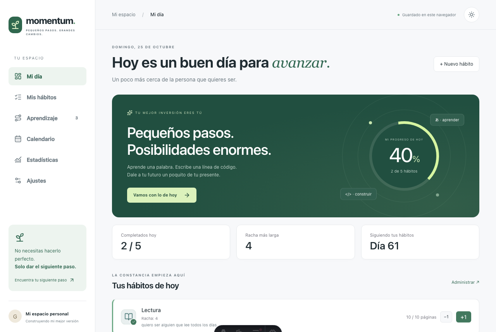

<div align="center">

# 🌱 Momentum

**Pequeños pasos. Grandes cambios.**

Un espacio personal para construir hábitos, aprender de forma guiada y
cuidar rutinas de bienestar — todo en tu navegador, sin cuentas ni
servidores.

[](./LICENSE)
[](https://astro.build)
[](https://react.dev)
[](https://tailwindcss.com)
[](https://vitest.dev)



</div>

---

## ✨ Qué incluye

- **Hábitos personalizados** — binarios (sí/no), de cantidad o de
  duración, con meta diaria y un "por qué" opcional que ancla el hábito a
  una identidad.
- **Dashboard diario** con registro de un tap, tarjetas resumen y un
  heatmap de contribuciones estilo GitHub para ver tu constancia de un
  vistazo.
- **Calendario mensual** para revisar tu historial y corregir un día que
  se te pasó.
- **Estadísticas** con tendencia de cumplimiento, totales semanales y
  racha actual/mejor racha por hábito.
- **Aprendizaje guiado** — tres rutas con lecciones, material, práctica y
  evidencia auto-reportada (inglés, japonés, Java). Nunca asigna un nivel
  automáticamente: el progreso lo documentas tú.
- **Hábitos de bienestar** activados por defecto (higiene, movimiento)
  como punto de partida razonable.
- **Modo claro/oscuro** persistido, con transición animada.
- **Exportar/importar** un respaldo completo en JSON desde `/settings`.

Todo el diseño sigue principios de psicología del comportamiento: rachas
visibles, refuerzo positivo sin culpa (nunca rojo para un día no
cumplido) y fricción mínima para registrar un hábito. Ver
[`docs/design.md`](./docs/design.md) para el detalle completo.

## 🧱 Stack

| | |
|---|---|
| **Framework** | [Astro](https://astro.build) (salida estática) + islas de [React 19](https://react.dev) |
| **Estilos** | [Tailwind CSS v4](https://tailwindcss.com) |
| **Estado** | [nanostores](https://github.com/nanostores/nanostores), compartido entre islas |
| **Fechas** | [date-fns](https://date-fns.org) |
| **Gráficas** | [recharts](https://recharts.org) |
| **Íconos** | [lucide-react](https://lucide.dev) |
| **Tests** | [Vitest](https://vitest.dev) + React Testing Library |
| **Persistencia** | `localStorage` del navegador, sin backend |

## 🚀 Empezar

```sh
npm install
npm run dev          # http://localhost:4321
```

| Comando | Qué hace |
|---|---|
| `npm run dev` | Servidor de desarrollo |
| `npm run build` | Build de producción en `./dist/` |
| `npm run preview` | Sirve el build localmente |
| `npm run test` | Corre la suite de Vitest |
| `npm run astro check` | Chequeo de tipos de Astro/TypeScript |

## ☁️ Desplegar

Es un sitio 100% estático (`output: "static"`), sin variables de entorno
ni backend. Vercel y Netlify detectan Astro automáticamente:

| Ajuste | Valor |
|---|---|
| Build command | `npm run build` |
| Output directory | `dist` |

Conecta este repositorio desde el dashboard de la plataforma, o usa su
CLI (`vercel` / `netlify deploy`) desde la raíz del proyecto.

## 🔒 Datos y privacidad

No hay servidor ni analítica: todo vive en el `localStorage` de tu
navegador. Desde `/settings` puedes exportar un respaldo en JSON y
volver a importarlo — útil si cambias de navegador, limpias el caché por
accidente, o quieres migrar tus datos.

## 📄 Licencia

[MIT](./LICENSE) © Guillermo Díaz Ramos
