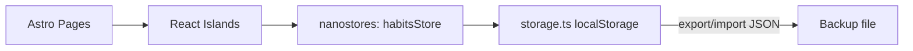

# Diseño - Rastreador de Hábitos

## Stack técnico

- **Astro** — generador de sitios, páginas estáticas con islas de
  interactividad.
- **React** — componentes interactivos (islas), vía `@astrojs/react`.
- **TypeScript** en modo `strict`.
- **Tailwind CSS** — utilidades de estilo, modo oscuro con la estrategia
  `class`.
- **nanostores** — estado compartido entre islas (hábitos y registros),
  sincronizado con `localStorage`.
- **date-fns** — cálculos de fechas, rachas y grillas de calendario.
- **recharts** — gráficas de progreso.
- **lucide-react** — iconos.
- **Vitest + React Testing Library** — pruebas unitarias y de componentes.

## Arquitectura



- Cada página `.astro` renderiza su contenido estático y monta las islas de
  React que necesita, con la estrategia de hidratación más barata que
  funcione (`client:visible` o `client:idle` cuando no se necesita
  interactividad inmediata, `client:load` solo cuando sí).
- Todas las islas leen/escriben al mismo store de `nanostores`
  (`src/lib/stores/habitsStore.ts`), que a su vez persiste a través de
  `src/lib/storage/storage.ts`.
- `storage.ts` es la única capa que toca `localStorage` directamente. Incluye
  número de versión de esquema para poder migrar datos en el futuro (por
  ejemplo, al migrar a Supabase en la edición 2).

## Modelo de datos

```ts
type HabitUnit = "boolean" | "count" | "duration";

interface Habit {
  id: string;
  name: string;
  why?: string; // motivación / identidad (Atomic Habits)
  unit: HabitUnit;
  unitLabel?: string; // ej. "páginas", "minutos"
  dailyGoal?: number; // solo aplica si unit !== "boolean"
  color: string; // token de la paleta
  createdAt: string; // ISO date
  archived: boolean;
}

interface HabitLog {
  habitId: string;
  date: string; // YYYY-MM-DD, hora local
  value: number; // 1/0 para boolean, cantidad para count/duration
  note?: string;
}
```

## Páginas

| Ruta | Contenido |
|---|---|
| `/` | Dashboard: tarjetas resumen, heatmap estilo GitHub, hábitos de hoy con registro rápido |
| `/habits` | Alta, edición, archivo y eliminación de hábitos |
| `/calendar` | Vista mensual tipo heatmap, edición retroactiva |
| `/stats` | Gráficas de tendencia y tabla de rachas / % cumplimiento |
| `/settings` | Exportar/importar JSON, toggle de tema |

## Sistema de diseño

### Estilo visual: "cristal" (glassmorphism)

Tras la primera vuelta de feedback, el diseño se ajustó a un estilo tipo
cristal: fondo con gradiente diagonal (claro: `sky-200 → indigo-50 →
emerald-200`; oscuro: `indigo-950 → slate-900 → emerald-950`) y paneles
translúcidos con blur encima (clase `.glass` en `global.css`: fondo
semitransparente, `backdrop-filter: blur(20px) saturate(160%)`, borde
sutil y sombra suave). La barra superior (header + nav) también es un
panel de cristal fijo (`sticky`). Los controles de formulario
(inputs/selects) se mantienen con fondo sólido para legibilidad; el
cristal es para los paneles contenedores, no para el texto editable.

### Dashboard: heatmap estilo GitHub

El dashboard (`/`) usa un heatmap de contribuciones estilo GitHub
(`ContributionHeatmap`, últimas ~20 semanas) como la forma principal de
ver el progreso de un vistazo, antes del widget de "hoy". Es solo
visualización (no editable); para corregir un día puntual sigue estando
la página `/calendar` con su panel de edición retroactiva.

### Modo claro / oscuro

- Tailwind con `darkMode: "class"`.
- El tema se guarda en `localStorage` bajo una clave propia
  (`habit-tracker:theme`).
- Al cargar, si no hay preferencia guardada, se usa
  `window.matchMedia("(prefers-color-scheme: dark)")`.
- Un toggle accesible (botón con `aria-pressed`) disponible en el layout
  principal, visible en todas las páginas.

### Paleta

| Token | Uso | Claro | Oscuro |
|---|---|---|---|
| `bg` | Fondo principal | `#FAFAF9` (stone-50) | `#18181B` (zinc-900) |
| `surface` | Tarjetas | `#FFFFFF` | `#27272A` (zinc-800) |
| `text` | Texto principal | `#18181B` | `#F4F4F5` |
| `text-muted` | Texto secundario | `#71717A` | `#A1A1AA` |
| `progress` | Progreso / en curso | `#0EA5E9` (sky-500) | `#38BDF8` (sky-400) |
| `success` | Hábito cumplido | `#10B981` (emerald-500) | `#34D399` (emerald-400) |
| `achievement` | Racha / logro | `#F59E0B` (amber-500) | `#FBBF24` (amber-400) |
| `neutral-missed` | Día no cumplido | `#D4D4D8` (zinc-300) | `#3F3F46` (zinc-700) |

Nunca se usa rojo para marcar un día no cumplido: se usa `neutral-missed`,
un gris neutro, para evitar el diseño basado en culpa.

Debe verificarse contraste AA (mínimo 4.5:1 para texto normal) en ambos
modos antes de dar por cerrada la Task 11.

### Tipografía

- Fuente del sistema (`font-sans` de Tailwind) para evitar pesos de carga
  extra; prioridad en rendimiento sobre personalización tipográfica.
- Jerarquía clara: títulos de página `text-2xl font-semibold`, tarjetas de
  resumen con el número destacado en `text-3xl font-bold`.

## Principios psicológicos aplicados

1. **Don't break the chain** (método Seinfeld): racha visible en cada
   hábito + heatmap mensual tipo GitHub. Aprovecha la aversión a la pérdida:
   es más motivador no "romper" una racha visible que empezar una nueva.
2. **Refuerzo positivo sin culpa**: día cumplido en color vibrante
   (`success`), día no cumplido en `neutral-missed`. Nunca mensajes de
   "fallaste" ni iconografía de alerta/error para un día no registrado.
3. **Fricción mínima**: registrar un hábito booleano es un solo tap; los de
   cantidad usan un input numérico grande con incrementos rápidos. La
   sección "hoy" siempre es lo primero que se ve en el dashboard.
4. **Retroalimentación visual de progreso**: barras de progreso hacia la
   meta diaria, racha actual y mejor racha histórica, porcentaje de
   cumplimiento semanal/mensual. Refuerza la autoeficacia (ver el progreso
   acumulado, no solo el día de hoy).
5. **Hábitos basados en identidad** (*Atomic Habits*, James Clear): campo
   opcional "por qué" al crear un hábito (ej. "porque quiero ser alguien
   que lee todos los días"), mostrado como recordatorio sutil en el detalle
   del hábito.

## Buenas prácticas de Astro

- Preferir `.astro` estático para todo lo que no necesita interactividad
  (layouts, textos, estructura de página).
- Toda isla que lea datos de `localStorage` (directamente o vía
  `habitsStore`/`themeStore`) debe usar **`client:only="react"`**, no
  `client:load` ni `client:visible`. Astro no tiene acceso a `localStorage`
  al generar el HTML estático, así que si la isla se renderiza también en
  el servidor, el primer render del cliente (con datos reales) no coincide
  con el HTML del servidor (datos vacíos) y React tira un error de
  hidratación, forzando un re-render completo de forma inestable.
  `client:only="react"` le dice a Astro que no la renderice en el
  servidor en absoluto, evitando el problema de raíz.
- Para islas que no dependen de `localStorage` (si las hay en el futuro),
  sí usar `client:visible`/`client:idle` por defecto para hidratar lo
  menos posible; `client:load` solo si deben responder de inmediato.
- TypeScript en modo `strict`, sin `any` implícitos.
- Estructura de carpetas por dominio:
  ```
  src/
    components/
      habits/
      calendar/
      stats/
      ui/          (botones, inputs, tarjetas genéricas)
    lib/
      storage/
      stores/
      utils/       (fechas, agregaciones)
    layouts/
    pages/
  ```
- Las islas de React reciben datos vía props o se suscriben directamente al
  store de `nanostores`; evitar pasar el store completo como prop gigante.

## Buenas prácticas de React

- Solo componentes funcionales con hooks.
- Respetar las reglas de hooks (no condicionales, no en loops).
- Memoización (`useMemo`/`useCallback`) solo cuando hay un costo de cálculo
  real o se evita una re-renderización costosa; no memoizar por defecto.
- Accesibilidad:
  - Controles interactivos con `aria-label` cuando no hay texto visible.
  - Calendario navegable por teclado (flechas, Enter para seleccionar un
    día).
  - Gráficas con una tabla o resumen textual alternativo para lectores de
    pantalla.
  - Foco visible (`focus-visible`) en todos los elementos interactivos.
- Testing: Vitest + React Testing Library, probando comportamiento
  (qué ve y qué puede hacer el usuario), no detalles de implementación.

## Testing general

- TDD en lógica pura: `storage.ts`, cálculo de rachas, agregaciones de
  estadísticas. Se escribe el test antes de la implementación.
- Tests de comportamiento en UI crítica: formulario de hábitos, flujo de
  exportar/importar.
- `localStorage` se simula en los tests (jsdom) para no depender de un
  navegador real.

## Momentum y rutas de aprendizaje (octubre 2026)

El diseño usa navegación lateral en escritorio, navegación horizontal en móvil,
paneles sólidos, acentos verdes, tema claro/oscuro y animaciones que respetan
`prefers-reduced-motion`. `/learning` contiene tres rutas con 64 objetivos y retos.
Los recursos externos se abren desde cada ruta.

`HabitTrackerData.learning` es una extensión opcional compatible con los respaldos
v1 anteriores. Asocia cada ruta con un `habitId` y una lista de objetivos completados.
`LearningInit` agrega inglés (15 min), japonés (15 min) y Java (25 min) una sola vez;
reutiliza un hábito con el mismo nombre, unidad de duración y etiqueta «minutos».
No modifica hábitos ni registros existentes. Los objetivos no crean registros de
estudio: los minutos se anotan en el widget compartido con calendario y estadísticas.
Las metas se pueden editar desde Hábitos. Archivar o eliminar un hábito no elimina
el aprendizaje ni lo recrea automáticamente; la ruta ofrece reactivarlo explícitamente.
El respaldo incluye los objetivos. Importar un respaldo antiguo agrega las rutas
si aún no incluye el campo `learning`. Los niveles son orientativos, no certificaciones.

## Revisión del currículo: aprendizaje guiado

Esta revisión sustituye el temario inicial de 64 marcas por **54 módulos**:
16 de inglés, 23 de japonés y 15 de Java. La fuente está en
`src/lib/curriculum/`. Cada módulo define un ID estable, requisitos sugeridos,
objetivo, explicación y ejemplo en español, recursos con instrucciones de uso,
práctica, ejercicio con solución explicada, evidencia, tres criterios y repaso.
Las horas son estimaciones editoriales del trabajo propuesto, no equivalencias
con niveles ni garantías de dominio. Los nombres A1/A2/B1/B2 describen material.

La pantalla presenta un índice navegable y una sola lección a la vez. Se puede
explorar sin bloqueo; al volver se abre el primer módulo aún no documentado.
El parámetro `path` conserva el desafío seleccionado en la URL. Los módulos
largos de Irodori Elemental se separan en bloques de tres lecciones.

### Persistencia y compatibilidad

- Las nuevas marcas usan `v2:<lesson-id>:<step>`, independientes del índice.
- Las marcas anteriores se conservan, pero no se asignan a contenido distinto.
- `LearningProgress.notes` es opcional, por módulo, y viaja en respaldos v1.
- Para documentar un módulo se requieren material, práctica, repaso, sus tres
  criterios y evidencia escrita de al menos 30 caracteres. Esto solo valida la
  integridad del registro: no evalúa la calidad de la evidencia ni el dominio.
- Desmarcar un requisito o borrar la evidencia reabre el módulo. Las actividades
  nunca crean minutos, rachas ni registros de hábitos.
- La autoevaluación y el repaso se declaran por el usuario; no hay calificador,
  evaluación de audio/código ni calendario automático de repasos.
- Los hábitos mantienen IDs, metas, historial y archivo; eliminar un hábito
  no elimina notas o aprendizaje. Se conserva la reactivación explícita.

### Fuentes y criterio editorial

Enlaces contrastados el 25 de octubre de 2026: British Council LearnEnglish
(gramática, videos y cuatro habilidades); Japan Foundation Irodori y Marugoto
(PDF en español, kana, audio); Dev.java, Oracle, Spring, Maven, JUnit, PostgreSQL
y el libro de Git. Helsinki Java MOOC se identifica como material archivado;
sus ejercicios se pueden resolver localmente si las herramientas antiguas fallan.
Los recursos pueden requerir cuenta en partes de sus servicios. La selección
no depende de comprar un curso. Las explicaciones y prácticas de la app son
una guía propia, y las fuentes se abren externamente, sin copiar sus cursos.
